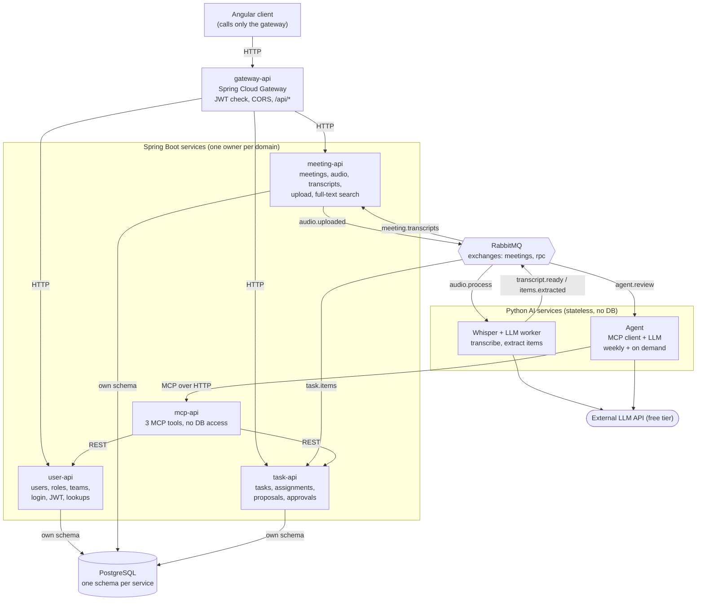

# Meeting Recorder

Distributed Java application (PCBE, stage 2). Users upload or record a meeting or lecture. The system
transcribes it and extracts **tasks** (action items). A weekly **agent** then finds overdue and unassigned items and
overloaded owners and **proposes assignments**. A human approves each proposal.

Built from an API gateway, Spring Boot microservices, Python AI workers, RabbitMQ, PostgreSQL, an MCP server and
an LLM agent. Team of 4. The full plan is in [`Meeting_Recorder.pdf`](Meeting_Recorder.pdf).

---

## Architecture



### Components

| Component        | Module / folder        | Tech                                | Owns / role |
|------------------|------------------------|-------------------------------------|-------------|
| Angular client   | `frontend/`            | Angular 21, TypeScript              | Record or upload, transcripts, search, approval queue, "Run review now" demo button. Calls **only** the gateway |
| API gateway      | `backend/gateway-api`  | Spring Cloud Gateway (WebMVC)       | Single entry point: routing, JWT check, CORS |
| user-service     | `backend/user-api`     | Spring Boot                         | Sole owner of users, roles and teams. Login and JWT, owner lookup |
| meeting-service  | `backend/meeting-api`  | Spring Boot                         | Sole owner of meetings, audio files and transcripts. Upload, full-text search, RabbitMQ publisher and consumer |
| task-service     | `backend/task-api`     | Spring Boot                         | Sole owner of tasks, assignments and proposals. Approvals, overdue and workload queries, consumer for extracted items |
| mcp-server       | `backend/mcp-api`      | Spring Boot (Spring AI MCP, later)  | The 3 MCP tools. Calls task-api and user-api over REST. **No database access** |
| AI services      | _(to be added)_        | Python, FastAPI, faster-whisper, LangChain | Stateless transcription/extraction worker and the agent |
| Infra            | `docker/`              | Docker Compose, RabbitMQ, PostgreSQL | Broker, and one database with one schema per service |

### How the components communicate

- The client talks **only** to the API gateway.
- Audio, transcripts and extracted items move between meeting-api, task-api and the Python worker through **RabbitMQ**.
- The agent reads data and proposes changes **only through the MCP server**, which calls the Spring services over REST.
- The LLM calls for extraction and for the agent go to an external free-tier API.

### Event flow

1. The client uploads audio through the gateway to **meeting-api**, which stores it and creates a meeting with status `PROCESSING`.
2. meeting-api publishes `meeting.audio.uploaded` to the `meetings` exchange (queue `audio.process`).
3. The Python worker consumes it and runs Whisper. An LLM then extracts tasks (text, owner if mentioned, deadline).
   The worker publishes `meeting.transcript.ready` and `meeting.items.extracted`.
4. meeting-api consumes the transcript (queue `meeting.transcripts`) and saves it. The meeting becomes `READY`.
5. **task-api** consumes the items (queue `task.items`), resolves owner names through user-api, and saves them.
6. Weekly, the agent connects to the MCP server, reads overdue and unassigned items plus owner workload, and calls
   `propose_assignment`. For demos, a **"Run review now"** button (through the gateway) triggers the same run on seeded data.
7. The MCP server asks task-api to save each result as a `PENDING` proposal.
8. A human approves it in the UI. task-api applies the change.

### Data ownership rules

- **One PostgreSQL database, one schema per service** (`user_schema`, `meeting_schema`, `task_schema`).
- Each domain has exactly one owning service. A service **never writes another service's tables**. It calls that
  service's API or sends a message. Cross-domain data is fetched through the owning service, **never joined across schemas**.
- All services connect with the same database user; each one works only in its own schema, which Hibernate creates
  on startup. Keeping to your own schema is a code-review rule.
- The Python services and the MCP server keep **no state** and have **no database access**.
- Search uses Postgres full-text search (`tsvector`) in meeting-api behind a regular REST endpoint (no vector DB).
- RabbitMQ messages are removed once acknowledged (no replay). Dead-letter queues catch failures.

### MCP tools (Spring server, streamable HTTP)

| Tool | Kind | Description |
|------|------|-------------|
| `get_overdue_items(since)` | read | Open tasks past their due date or with no owner, each with its meeting, days overdue and an unassigned flag |
| `get_owner_workload(days)` | read (stats) | Open and overdue items per person over the period |
| `propose_assignment(item_id, owner, reason)` | propose | Creates a `PENDING` assignment proposal for a human to approve |

All three are thin Java layers over REST: reads go to task-api and user-api, and `propose_assignment` goes to
task-api, which stays the only owner of tasks.

### Agent

The MCP server is passive: it lists tools and runs them when a client calls. The agent (Python, an MCP client plus an
LLM) is triggered by a weekly scheduler or by the "Run review now" button. One run:

1. Connects to the MCP server's `/mcp` endpoint and discovers the tools.
2. The LLM calls `get_overdue_items` (which also returns unassigned items), then `get_owner_workload`.
3. For each overdue item whose owner is overloaded, and for each unassigned item, it picks a teammate with spare
   capacity and calls `propose_assignment` with a written reason, e.g. _"Item 'Send budget draft' is 9 days overdue.
   Alex has 7 overdue items, and Sam has none."_
4. Each proposal is saved as `PENDING`. Nothing changes until a person approves it.

Read tools change nothing. The agent uses its own service credentials, so proposals are logged as created by the agent.
`propose_assignment` allows **one open proposal per item**, so a re-run creates no duplicates. Any MCP client (e.g.
MCP Inspector) can use the same server for demos and tests.

---

## Repository layout

```
.
├── backend/                 Maven reactor (Spring Boot 4.1, Java 25)
│   ├── pom.xml              parent POM: centralized versions, BOMs (Spring Cloud, Spring AI), module list
│   ├── mvnw, .mvn/          Maven wrapper
│   ├── gateway-api/         :8080  Spring Cloud Gateway (routes in application.properties)
│   ├── user-api/            :8081  web, JPA, AMQP, PostgreSQL, validation, actuator
│   ├── meeting-api/         :8082  same stack as user-api
│   ├── task-api/            :8083  same stack as user-api
│   └── mcp-api/             :8084  bare Spring Boot (MCP server to be added)
├── frontend/                Angular 21 (standalone, routing, SCSS); dev proxy /api -> :8080
├── docker/
│   ├── docker-compose.yml   PostgreSQL (latest) + RabbitMQ (management UI)
│   └── .env.example         credentials used by compose and the services (defaults match)
├── AGENTS.md                instructions for AI coding agents
└── .github/                 Copilot instructions (repo-wide + backend/frontend) and custom agents
```

### Ports

| Service | Port | Notes |
|---------|------|-------|
| frontend (dev) | 4200 | `npm start`, proxies `/api` to the gateway |
| gateway-api | 8080 | `/api/auth/**`, `/api/users/**`, `/api/teams/**` → user-api; `/api/meetings/**` → meeting-api; `/api/tasks/**`, `/api/proposals/**` → task-api |
| user-api | 8081 | schema `user_schema` |
| meeting-api | 8082 | schema `meeting_schema` |
| task-api | 8083 | schema `task_schema` |
| mcp-api | 8084 | no database |
| PostgreSQL | 5432 | db `meeting_recorder` |
| RabbitMQ | 5672 / 15672 | management UI: http://localhost:15672 (`meetingrecorder` / `meetingrecorder`) |

---

## Getting started

### Prerequisites

- **JDK 25** (the build fails fast with a clear message on older JDKs). On macOS: `export JAVA_HOME=$(/usr/libexec/java_home -v 25)`
- Docker (Desktop) with Compose
- Node.js 22+ and npm (Angular CLI is installed locally in `frontend/`)

### 1. Start the infrastructure

```bash
cd docker
cp .env.example .env          # optional, defaults are the same
docker compose up -d
docker compose ps             # both containers should be "healthy"
```

Reset all data with `docker compose down -v && docker compose up -d` (run inside `docker/`).

### 2. Build and run the backend

```bash
cd backend
./mvnw compile                                # builds all modules (JDK 25)
./mvnw -pl user-api spring-boot:run           # run a single service (repeat for the others)
```

In IntelliJ, open/import `backend/pom.xml` as a Maven project and use the generated `*ApiApplication` run configurations.

Health checks (show `db` and `rabbit` status):

```bash
curl localhost:8081/actuator/health
```

### 3. Run the frontend

```bash
cd frontend
npm install
npm start                     # http://localhost:4200, /api is proxied to the gateway
```

### Backend architecture

`backend/pom.xml` is the single parent: it centralizes all versions and lists the modules. Each service is **one Maven
module** with a layered package structure (`ro.pcbe.meetingrecorder.<service>.<layer>`):

```
controller  ->  service  ->  repository   (own schema, JPA)
(REST, MQ                \->  client       (REST clients to other services, RabbitMQ publishers)
 listeners)
```

| Layer | Responsibility |
|-------|----------------|
| `controller` | API entrypoints: REST controllers, RabbitMQ listeners (MCP tools in `mcp-api`). No business logic |
| `service` | Business logic and transactions |
| `repository` | Spring Data JPA, own schema only. **Not present in services without a database** (`mcp-api`) |
| `client` | Outbound calls to other services and RabbitMQ publishers |
| `model` / `dto` / `config` | JPA entities / request, response and message records / Spring configuration |

`gateway-api` is configuration-driven (routes in `application.properties`).

Modules start with only their `*ApiApplication` class. A layer's package is created when its first real class is
added; there are no placeholder packages or `package-info.java` files (component scanning covers the application package).
Configuration uses `application.properties`.

### Naming

One concept, one name, everywhere (Java, database, REST, JSON, messages, config, TypeScript, docs). The canonical
glossary and casing rules are in [`.github/copilot-instructions.md`](.github/copilot-instructions.md#naming-consistency-required);
for example the task concept is always `Task` / `task` / `/api/tasks` / `taskId`, never `ActionItem`.

### Database

Each service owns its schema. During these early stages the tables are created and updated by Hibernate
(`ddl-auto: update`); there is no migration tool yet. `update` adds tables and columns but doesn't rename or drop
them, so reset local data with `cd docker && docker compose down -v && docker compose up -d` after breaking entity changes.

### AI agents

Copilot custom agents live in `.github/agents/`: `orchestrator` runs the delivery pipeline (clarify → `planner` →
`executor` → logging/docs → `pr-reviewer` / `security-reviewer` → handoff), and `explore` answers codebase questions.
See [`AGENTS.md`](AGENTS.md).

---

## Work split

| Person | Owns | Main deliverables |
|--------|------|-------------------|
| 1. Users and gateway | user-api, gateway-api | Users, roles, teams, login and JWT, gateway routes and auth filter, owner lookup endpoint |
| 2. Meetings and messaging | meeting-api | Upload and file storage, transcripts, full-text search, RabbitMQ publisher and consumer, queues and dead-letter setup |
| 3. Tasks and MCP | task-api, mcp-api | Tasks, proposals, approvals, overdue and workload queries, consumer for extracted items, the 3 MCP tools |
| 4. AI, frontend and infra | Python services, frontend, Docker | Whisper pipeline, LLM extraction, agent and scheduler, Angular UI, Docker Compose, CI, seed data |

**Shared first:** agree on the REST contracts (one OpenAPI file per service), the RabbitMQ exchange, routing keys and
message schemas, and the MCP tool schemas, all in one `contracts/` folder. After that everyone works in parallel against mocks.

## Timeline

| Phase | Goal |
|-------|------|
| Week 5 | Submit the topic proposal. Confirm with the teacher how components are counted. Agree on contracts, repo layout and the Compose skeleton |
| Phase 1 | Walking skeleton: the gateway routes to the three services, login works, an upload sends a message, a fake transcript comes back and shows in the UI |
| Phase 2 | Real Whisper plus extraction. task-api saves the items. Approval flow works |
| Phase 3 | MCP server (3 tools) and agent end to end. Full-text search |
| Phase 4 | Polish: retries and dead-letter queues, docs, demo script, seeded recordings |

## Risks

- **Whisper speed on CPU:** use `small` or `base`, keep demo clips short, process asynchronously. RabbitMQ prefetch = 1 on the worker.
- **Contract drift between teams:** one `contracts/` folder (OpenAPI, message schemas, MCP tool schemas), reviewed by two people.
- **Ownership rule:** no service writes another service's tables (checked in code review).
- **Component counting:** confirm with the teacher that the independent Spring services count as separate components.
- **Agent quality:** keep its job narrow (overdue and unassigned items, overloaded owners), always require human approval.
- **LLM cost and limits:** use a free-tier API for extraction and the agent.
- **Keyword search:** full-text search won't match "budget concerns" to "we're short on money". Acceptable for a demo.
- **Uneven load:** person 4 has the widest scope. Move the approval UI to person 3 or the agent to person 1 if needed.

## Open points

- The diagram shows `rpc: users.* / tasks.* / requests` over RabbitMQ, while the PDF says the MCP server calls the
  services over **REST**. Decide on one before writing the contracts.
- The diagram routes "Run review now" as `review.requested` → `agent.review` through RabbitMQ to the agent.
- Planned: a Maven profile that builds and pushes a Docker image per service.
